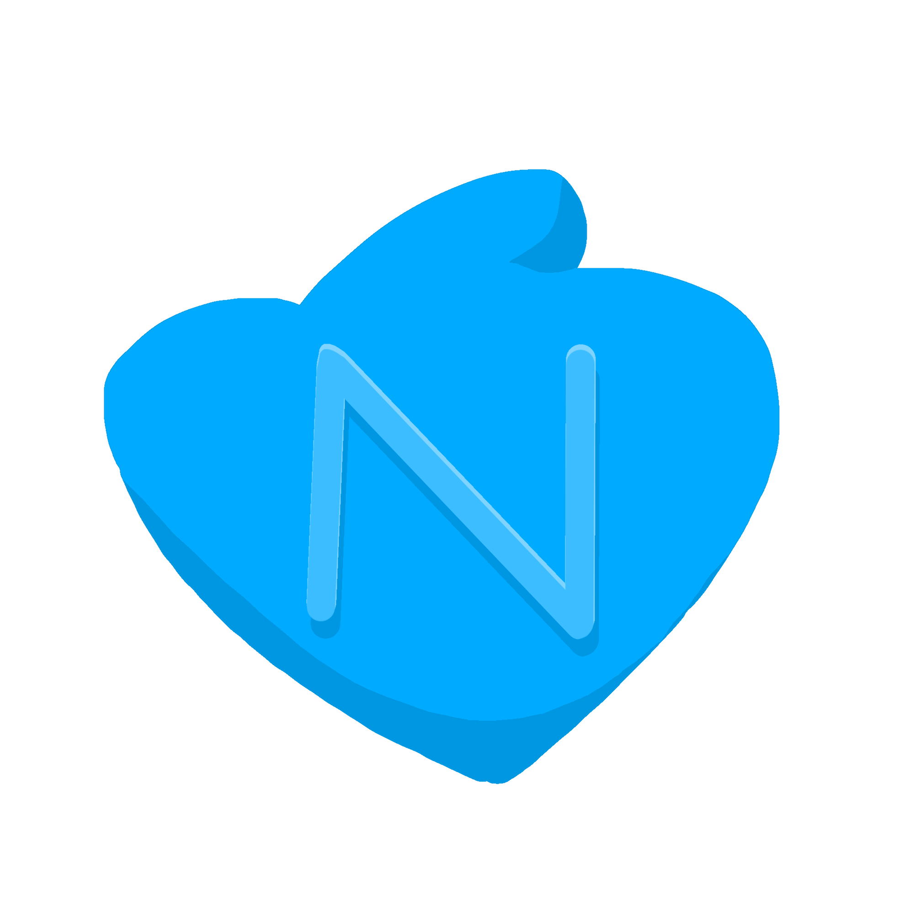

# NEXUS Engine

A Friday Night Funkin’ engine with custom features, tools, editors, and improvements.

# About

NEXUS Engine is a rewritten Version of Friday Night Funkin’ Psych Engine focused on adding new features and improving the modding experience.

The project includes custom editors, redesigned interfaces, additional gameplay features, and mobile support.

# Warning

This project is mainly developed by one person. Updates and features may take time, and development progress can vary.

# Features

NEXUS Engine Features

* Feature	Progress
* New Stage Editor	90%
* Weekend 1	75%
* Pico Mixes	0%
* Erect and Nightmare Mixes	0%
* V-Slice Chart Reader	0%
* Psych Chart to V-Slice Chart Converter	0%
* Game Over Videos in Chart Editor	0%
* New Main Menu UI	100%
* Freeplay Character Selection	0%
* Note Skin Selector	100%
* V-slice Mod Support 0%

More features are planned.

# Credits

* NexaII-Z - NEXUS Engine Owner and Developer.

# Psych Engine Credits

* Shadow Mario - Programmer.
* Riveren - Artist.

# Psych Engine Special Thanks

* bbpanzu - Former Programmer.
* Yoshubs - Former Programmer.
* SqirraRNG - Crash Handler and Chart Editor Waveform Base Code.
* KadeDev - Chart Editor Improvements and Other Pull Requests.
* iFlicky - Composer of Psync and Tea Time, Dialogue Sounds.
* PolybiusProxy - MP4 Video Loader Library (hxCodec).
* Keoiki - Note Splash Animations.
* Smokey - Sprite Atlas Support.
* Nebula the Zorua - Lua Reworks.
* superpowers04 - LuaJIT Fork.

⸻

# Development

NEXUS Engine is still in development. Features may change, get improved, or be delayed as development continues.

Thanks to everyone who has contributed to the project and supported its development.
